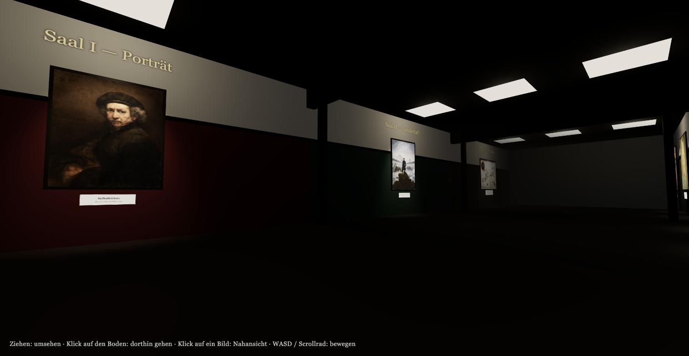

# 3D Museum

A walkable 3D art gallery in the browser — three themed halls (Portrait, Landscape, Modern), nine masterpieces, built with [Three.js](https://threejs.org/). Single self-contained `index.html`, no build step, no dependencies to install.

**[Live demo →](https://helmutqualtinger.github.io/Museum3d/)**



## Features

- Navigation that follows familiar web conventions — drag to look, click the floor to walk there, click a painting to view it
- Three galleries: Portrait, Landscape, and Modern art, each with its own accent color and lighting
- High-resolution paintings loaded from Wikimedia Commons, lit by narrow spots that pick out the artwork without washing it out
- Hovering a painting shows its title and artist; clicking walks you up to it, even from another hall
- Collision detection against walls so you can't walk through them
- Works on touch devices: drag to look, tap to select

## Controls

| Action | Input |
| --- | --- |
| Look around | Drag (the scene follows your pointer, like a map) |
| Walk to a spot | Click the floor there |
| View a painting | Click it — you'll be walked in front of it |
| Leave the close-up | Click beside the painting, the **← Zurück** button, or `Esc` |
| Move | `W` `A` `S` `D` / arrow keys, or the scroll wheel |
| Menu | `Esc` |

## Running locally

This is a single static HTML file — just open it in a browser, or serve it locally:

```bash
python3 -m http.server 8000
```

Then visit `http://localhost:8000`.

## Tech

- [Three.js](https://threejs.org/) r160, loaded via CDN import map — no npm install required
- Vanilla JavaScript (ES modules), no framework
- Artwork textures loaded on demand from Wikimedia Commons
